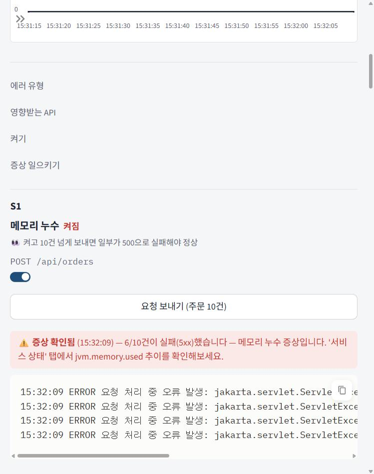
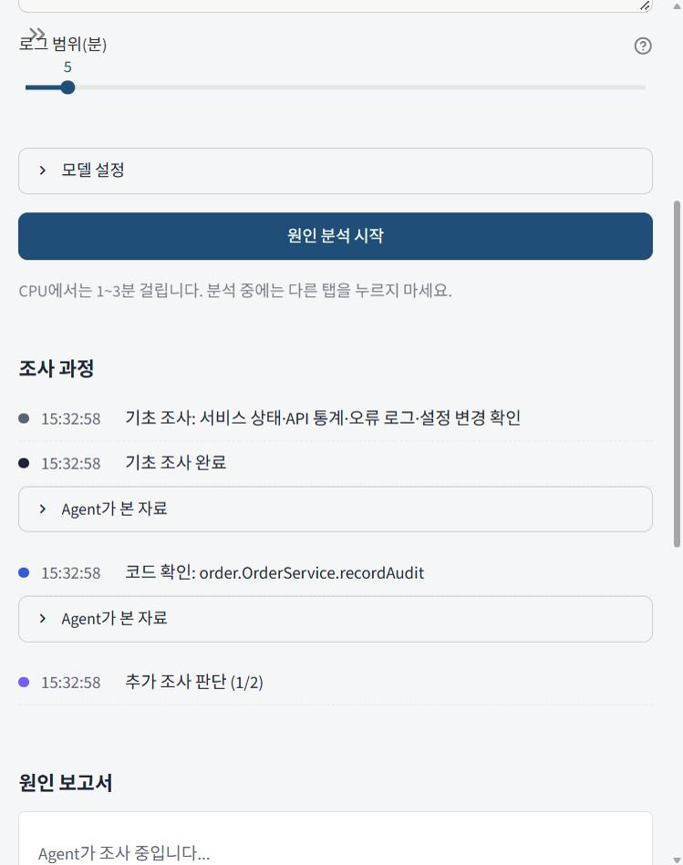
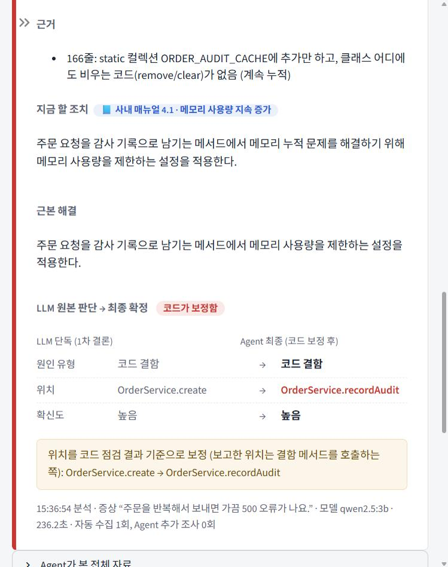

# 장애 대응 AI Agent (Incident Response Agent)

Spring Boot 마이크로서비스 환경에서 **장애를 스스로 조사하고 원인을 진단하는 AI Agent**를 만든 개인 프로젝트입니다.
실제 서비스를 2개(주문/재고) 띄워 32가지 장애를 재현할 수 있는 "테스트베드"와, 그 장애를 조사하는 **LangGraph 기반 Agent**,
그리고 둘을 연결해 시연·평가할 수 있는 **Streamlit 콘솔**로 구성되어 있습니다.

> 사람이 장애 신고를 받으면 로그를 보고, 의심되는 코드를 읽고, 설정값을 확인하며 원인을 좁혀 갑니다.
> 이 Agent는 그 과정을 그대로 흉내 내되, 작은(3B) 로컬 LLM도 안정적으로 쓸 수 있도록
> **"반드시 해야 할 기초 조사는 코드가 하고, LLM은 판단만 맡는"** 구조로 설계했습니다.

---

## 1. 데모

| 장애 재현 & 결과 확인 | Agent 조사 과정 (실시간) | LLM 단독 vs 코드 보정 비교 |
|---|---|---|
|  |  |  |
| 장애를 켠 뒤 요청을 보내면 콘솔에 증상이 바로 나타납니다 | 기초 조사 → 증거 수집 → (필요하면) 추가 조사 → 결론 | 작은 모델이 놓친 걸 코드가 보정하는 과정을 그대로 공개 |

실행 화면은 아래 "콘솔 사용법"을, 평가 결과는 "7. 평가 결과"를 참고하세요.

---

## 2. 왜 이런 구조로 만들었나

- **멀티 서비스**: 장애가 한 서비스 안에서 끝나지 않고 다른 서비스로 전파되는 경우(예: 재고 서비스 장애 → 주문 생성 실패)까지
  다루고 싶어서, 주문(order-service)과 재고(inventory-service)를 별도 프로세스로 분리했습니다.
- **코드 + LLM 하이브리드**: 3B급 로컬 모델 혼자서는 "오류 로그를 끝까지 추적했는지", "정말 코드에 결함이 있는지" 같은
  사실 확인을 놓치기 쉽습니다. 그래서 사실 확인(로그 수집, 코드 읽기, 설정 조회, 결론 검증)은 코드가 **항상** 하고,
  LLM은 "무엇을 더 봐야 하는지"와 "최종 원인이 무엇인지" 판단만 맡습니다.
- **공정한 평가**: Agent가 쓰는 도구에는 장애 재현 장치(`chaos` 패키지, `/chaos` API)가 보이지 않습니다. 정답을 미리 알고
  조사하는 상황을 막기 위해서입니다. 장애 스위치는 Agent에게 평범한 기능 플래그처럼 보입니다.
- **증상 문장의 자연스러운 변형 대응**: "주문 생성" 같은 사전 등록 키워드와 실제 증상 문장("주문**을** 생성하면...")
  사이에 조사가 끼어들어도 놓치지 않도록, 키워드 매칭 전에 조사를 떼어내는 정규화를 적용했습니다.

---

## 3. 아키텍처

```
                 ┌───────────────────────┐
  증상 입력 ───▶ │   Streamlit 콘솔 (UI)  │ ──▶ 조사 과정 실시간 표시 + 원인 보고서
                 │   localhost:8501       │
                 └───────────┬───────────┘
                             │
                 ┌───────────▼────────────┐        ┌─────────────────────────┐
                 │   Agent (LangGraph)     │──읽기──▶│ order-service :8081     │
                 │   agent/incident_agent  │        │ 주문·결제·검색 API       │
                 │   qwen2.5:3b (Ollama)   │        │ + 장애 시나리오 S1~S30   │
                 └───────────┬────────────┘        └────────────┬────────────┘
                             │ 읽기                               │ HTTP 호출
                             ▼                                    ▼
                 ┌─────────────────────────┐        ┌─────────────────────────┐
                 │ inventory-service :8082 │◀───────│  InventoryClient         │
                 │ 재고 조회·차감 API       │        │  (주문 생성 시 재고 확보) │
                 │ + 장애 시나리오 M1~M2   │        └─────────────────────────┘
                 └─────────────────────────┘
```

- **order-service**: 주문·결제·검색 REST API. 내부 결함(S1~S23)과 가상 외부 결제사(PG) 장애(S24~S30) 30종을 켜고 끌 수 있습니다.
- **inventory-service**: 주문 생성 시 order-service가 호출하는 별도 프로세스. 응답 지연(M1)·내부 오류(M2) 전파를 재현합니다.
- **Agent**: 두 서비스의 로그·소스 코드·설정값을 모두 읽을 수 있고, 장애가 어느 서비스에서 비롯됐는지까지 추적합니다.
- **콘솔**: 서비스 상태 확인 → 장애 재현 → Agent 분석까지 한 화면에서 진행하고, 분석 결과를 정답과 자동 채점해 누적 기록합니다.

---

## 4. 폴더 구조

```
incident-agent/
├─ order-service/        주문 서비스 (Spring Boot) — 주문·결제·검색 API + 장애 30종(S1~S30)
├─ inventory-service/    재고 서비스 (Spring Boot) — 재고 조회·차감 API + 장애 2종(M1~M2)
├─ ui/                   장애 대응 콘솔 (Streamlit)
│  ├─ app.py              화면 전체 (서비스 상태 / 장애 재현 / Agent 분석 탭)
│  ├─ service_client.py   두 서비스에 대한 공용 HTTP·로그 클라이언트
│  └─ scoreboard.py        Agent 분석 결과 자동 채점·누적 기록
├─ agent/
│  ├─ incident_agent/      Agent 본체
│  │  ├─ graph.py            LangGraph 파이프라인 (기초조사→증거수집→추가조사→결론→검증)
│  │  ├─ tools.py            로그·코드·설정 조회 도구 (Agent가 실제로 호출하는 함수들)
│  │  ├─ config.py           서비스 주소·모델·로그/소스 경로 등 설정 (환경변수로 변경 가능)
│  │  ├─ llm.py              Ollama 연결
│  │  └─ runbook.py/.md      사내 런북(대응 매뉴얼) 검색
│  ├─ run_agent.py         터미널에서 Agent 단독 실행
│  └─ check_ollama.py      Ollama 모델별 응답 속도·도구 호출 지원 여부 확인
├─ scripts/
│  ├─ chaos_demo.py        장애 재현·시연 스크립트 (명령줄)
│  └─ eval_agent.py        시나리오 자동 재현→분석→채점 평가 스크립트
├─ scenarios/
│  ├─ answer_key.md         장애별 정답지 (평가 기준, 사람이 읽는 용)
│  └─ answer_key.json       자동 채점용
├─ data/
│  └─ scoreboard.jsonl     콘솔에서 돌린 Agent 분석 결과 누적 기록 (자동 채점 결과)
├─ docs/                  주차별 평가 결과 스냅샷
├─ start_all.bat          Ollama·두 서비스·콘솔을 한 번에 띄우고 브라우저를 엽니다
├─ stop_all.bat           전부 종료
└─ run_ui.bat             콘솔만 실행
```

---

## 5. 실행 방법 (Windows)

### 최초 1회 설치

| 프로그램 | 버전 | 확인 명령 |
|---|---|---|
| JDK | 17 이상 | `java -version` |
| Python | 3.10 이상 | `python --version` |
| Ollama | 최신 | `ollama list` |

```bat
py -3 -m pip install -r requirements.txt
ollama pull qwen2.5:3b
```

Gradle은 따로 설치하지 않아도 됩니다 — 각 서비스 폴더의 `gradlew.bat`이 처음 실행 시 자동으로 받습니다.

### 한 번에 실행

```bat
start_all.bat
```

Ollama → inventory-service(8082) → order-service(8081) → 콘솔(8501) 순으로 띄우고, 준비되면 브라우저를 자동으로 엽니다.
끌 때는 `stop_all.bat`.

### 따로 실행 (개발용)

```bat
cd inventory-service & gradlew.bat bootRun      REM 재고 서비스 먼저
cd order-service     & gradlew.bat bootRun      REM 주문 서비스 (재고 서비스를 호출하므로 먼저 떠 있어야 함)
py -3 -m streamlit run ui\app.py                REM 콘솔
```

---

## 6. 콘솔 사용법 (http://localhost:8501)

| 탭 | 내용 |
|---|---|
| **서비스 상태** | order-service 상태·DB·힙 메모리·커넥션 풀 지표, 추이 그래프, 최근 경고/오류 로그 (5초마다 자동 새로고침) |
| **에러 재현** | order-service 장애 S1~S30, inventory-service 장애 M1~M2를 각각 켜고 끄기 + "요청 보내기"로 증상을 바로 확인 |
| **원인 분석** | 증상을 사람이 쓰는 말투로 입력 → Agent 조사 과정이 실시간으로 표시 → 원인 보고서 (원인 유형·위치·근거·조치) |

원인 분석 결과는 미리 정해 둔 정답(`scenarios/answer_key.json`)과 자동으로 비교되어 **LLM 단독 정답률**과
**최종(코드 보정 후) 정답률**로 누적 기록됩니다 — "7. 평가 결과" 참고.

---

## 7. Agent 동작 구조

```
증상 입력
  ↓
① 기초 조사 (코드)    서비스 상태·지표, API별 요청 통계, 오류 로그(최근 순), 최근 설정 변경 확인
  ↓
② 증거 수집 (코드)    오류 발생 위치 코드 추적, 어느 서비스 호출인지 판별 후 그 서비스의 코드·설정까지 확인
                      (예: InventoryClient 호출이면 inventory-service의 설정·코드도 함께 조회)
  ↓
③ 추가 조사 (LLM)     더 볼 것이 있으면 도구 선택: 로그 검색 / 코드 읽기 / API 코드 추적 / 설정 조회 (최대 2회)
  ↓
④ 결론 (LLM)          원인 유형(코드 결함 / 설정 오류 / 외부 시스템 / 기타) · 위치 · 근거 · 조치를 JSON으로 작성
  ↓
⑤ 검증 (코드)          조사 사실과 모순되면 결론을 보정하고 보정 여부를 표시, 코드 위치의 실존 여부 확인
```

- 공정한 평가를 위해 Agent는 장애 재현 장치(`chaos` 패키지, `/chaos` API)를 볼 수 없습니다. 코드에 있는 장애 스위치는
  Agent에게 평범한 기능 플래그(`features.isOn("legacy-search-summary")` 등)처럼 보입니다.
- 증상 문장 매칭은 "주문 생성"처럼 조사 없이 등록된 키워드와 "주문**을** 생성하면" 같은 실제 문장 사이에 조사가 끼어들어도
  놓치지 않도록, 비교 직전에 양쪽에서 조사를 떼어내는 정규화를 거칩니다 (`graph.py`의 `symptom_focus`).

### 설정 (환경변수)

| 항목 | 기본값 | 환경변수 |
|---|---|---|
| 주문 서비스 주소 | http://localhost:8081 | `SERVICE_URL` |
| 재고 서비스 주소 | http://localhost:8082 | `INVENTORY_URL` |
| Ollama 주소 | http://localhost:11434 | `OLLAMA_BASE_URL` |
| 모델 | qwen2.5:3b | `AGENT_MODEL` |

---

## 8. 평가 결과

`data/scoreboard.jsonl`에 콘솔에서 돌린 모든 분석 결과가 쌓입니다 (증상 문장, 켜져 있던 시나리오, 정답, LLM 단독 판단,
최종 판단, 정답 여부). 시나리오를 1개만 켜고 돌린 분석 기준 누적 정답률은 다음과 같습니다.

| | 정답률 |
|---|---|
| LLM 단독 (검증·보정 전) | 약 53% |
| **Agent 최종 (코드 보정 후)** | **약 87%** |

즉, 작은(3B) 모델 혼자서는 절반 정도만 맞히지만, 기초 조사·증거 수집·결론 검증을 코드가 받쳐 주면
정답률이 크게 올라갑니다. 자동 평가는 `py -3 scripts\eval_agent.py`로 재현할 수 있습니다 (S1~S30을 자동으로
켜고·분석하고·끄며 채점, 서비스가 켜져 있어야 합니다).

---

## 9. 기술 스택

- **Backend**: Spring Boot 3.5 / Java 17, H2 (in-memory), Spring Actuator
- **Agent**: Python, LangGraph, Ollama (qwen2.5:3b)
- **Console**: Streamlit
- **평가**: 규칙 기반 자동 채점 (`scenarios/answer_key.json` 대조)

---

## 10. 라이선스

개인 학습 프로젝트입니다. 자유롭게 참고하셔도 됩니다.
